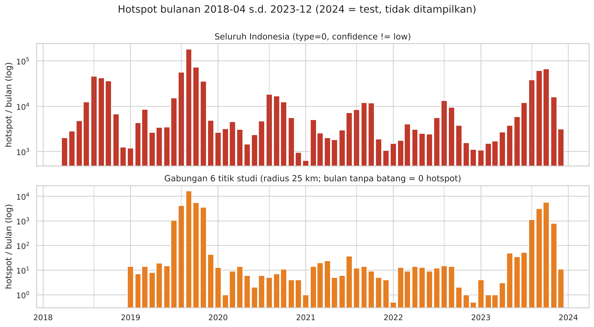
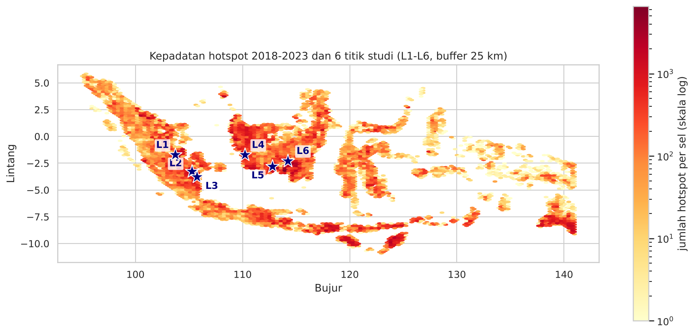
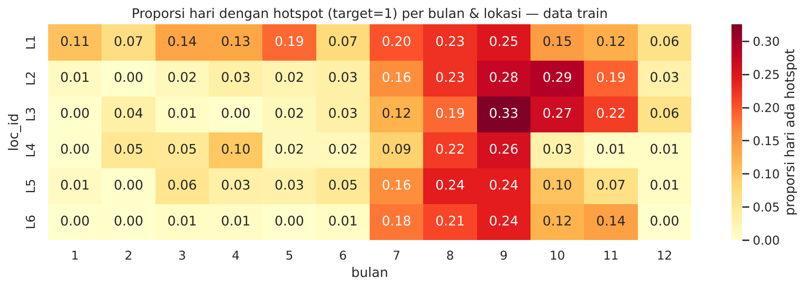
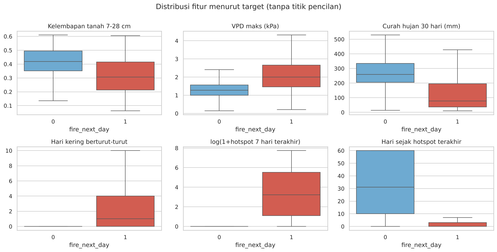
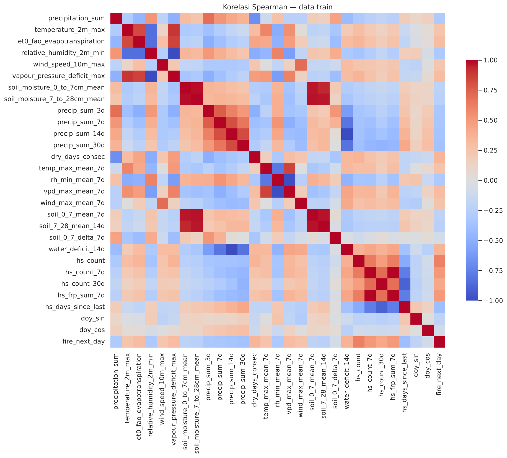
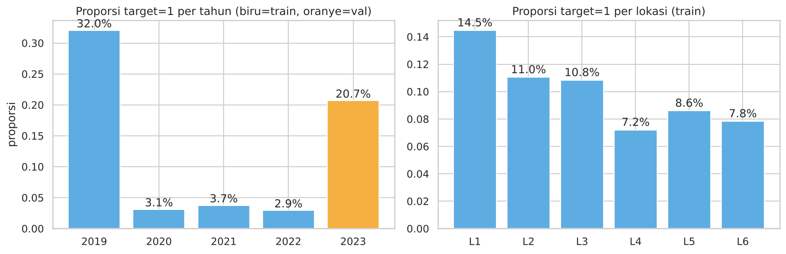
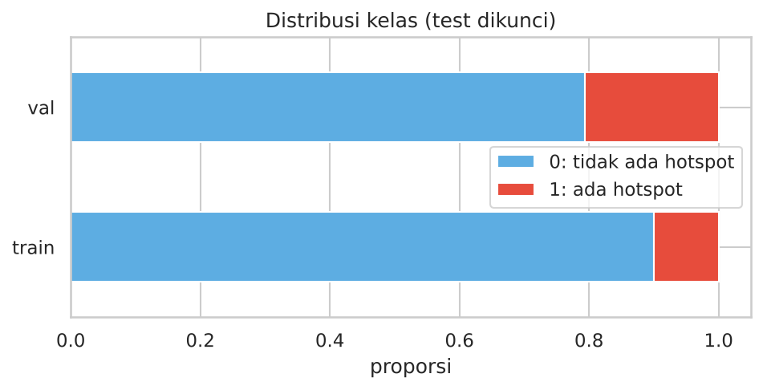

## INFORMASI PROYEK

**Judul Proyek:**  
Prediksi Resiko Titik Api Harian Untuk Peringatan Dini Karhutla Di Sumatra Dan Kalimantan

**Nama Mahasiswa:**

Adam Noverian

Fachrozzi Rizky Wibowo

**NIM:**

244311033

244311041

**Program Studi:**
Teknologi Rekayasa Perangkat Lunak

**Mata Kuliah:**
Data Science

**Dosen Pengampu:**
Gus nanang syaifuddiin, S.Kom., M.Kom.

**Tahun Akademik:**
2026 / Semester 5

**Link GitHub Repository:**
https://github.com/Swipezz/Prediksi-Kobong

**Link Video Pembahasan:**

**SDG yang Dipilih:**
SDG 13 – Climate Action

**Target SDG yang Relevan:**
SDG 15 - Life on Land


## 0. KERANGKA ML LIFECYCLE (L-M-O-P)

Laporan ini disusun mengikuti **ML Lifecycle** yang terdiri dari empat tahap berulang (iteratif):

| Tahap | Singkatan | Inti Pertanyaan | Bagian Laporan |
|-------|-----------|-----------------|----------------|
| **Learning Problem** | **L** | Apa target, objective, dan datanya? | Bab 2, 3, 4, 5 |
| **Model Design** | **M** | Model family/arsitektur apa, hypothesis space, dan inductive bias/asumsi apa? | Bab 6 (6.x.1 – 6.x.3) |
| **Optimization** | **O** | Bagaimana model dilatih: loss, optimizer, tuning, regularisasi, konvergensi? | Bab 6 (6.x.4 – 6.x.6) |
| **Predict & Evaluate** | **P** | Seberapa baik prediksi model berdasarkan metrik evaluasi? | Bab 7 |

```
   L (Learning Problem) ──► M (Model Design) ──► O (Optimization) ──► P (Predict & Evaluate)
          ▲                                                                   │
          └─────────────── iterasi / perbaikan berdasarkan hasil evaluasi ────┘
```

**Catatan untuk mahasiswa:** Setiap bagian diberi label **[L]**, **[M]**, **[O]**, atau **[P]**. Pastikan Anda dapat menjelaskan keterkaitan antar tahap, misalnya bagaimana hasil **P** mendorong perbaikan pada **L/M/O** (Bab 7.5).

---

## 1. LEARNING OUTCOMES
Pada proyek ini, mahasiswa diharapkan dapat:
1. **[L]** Mengidentifikasi masalah nyata dari **ide sendiri** yang selaras dengan salah satu tujuan **SDGs** ([Agenda 2030 – sdgs.un.org/2030agenda](https://sdgs.un.org/2030agenda)), lalu merumuskan problem statement (target, objective, data) secara jelas
2. **[L]** Melakukan analisis dan eksplorasi data (EDA) secara komprehensif (**OPSIONAL**)
3. **[L]** Melakukan data preparation yang sesuai dengan karakteristik dataset
4. **[M]** Merancang tiga model machine learning dengan justifikasi hypothesis space dan inductive bias (**WAJIB**):
   - Model baseline
   - Model machine learning / advanced
   - Model deep learning (**WAJIB**)
5. **[O]** Mengoptimasi model secara sistematis (loss function, optimizer, hyperparameter tuning, regularisasi)
6. **[P]** Menggunakan metrik evaluasi yang relevan dengan jenis tugas ML dan menganalisis hasilnya
7. Melaporkan hasil eksperimen secara ilmiah dan sistematis
8. Mengunggah seluruh kode proyek ke GitHub (**WAJIB**)
9. Menerapkan prinsip software engineering dalam pengembangan proyek

---

## 2. PROJECT OVERVIEW  **[L]**

### 2.1 Latar Belakang
Kebakaran hutan dan lahan (karhutla) merupakan permasalahan lingkungan yang sering terjadi di Sumatra dan Kalimantan. Dampaknya meliputi kerusakan ekosistem, pencemaran udara, dan gangguan kesehatan masyarakat. Salah satu faktor yang berkaitan dengan risiko kebakaran adalah suhu udara yang tinggi dan dapat mempercepat pengeringan vegetasi (Aflahah et al., 2019).

Proyek ini bertujuan membangun model machine learning untuk memprediksi risiko kemunculan titik api harian menggunakan data hotspot NASA FIRMS dan suhu udara Open-Meteo Historical Weather (ERA5). Hasil prediksi diharapkan dapat mendukung peringatan dini dan mitigasi karhutla, sekaligus berkontribusi pada SDG 13 (Climate Action) dan SDG 15 (Life on Land).

Referensi:Aflahah, E., et al. (2019). Pendugaan hotspot sebagai indikator kebakaran hutan di Kalimantan berdasarkan faktor iklim. Jurnal Pengelolaan Sumberdaya Alam dan Lingkungan, 9(2), 405–418. https://doi.org/10.29244/jpsl.9.2.405-418

### 2.2 Keterkaitan dengan SDGs (WAJIB)

Ide proyek **berasal dari mahasiswa** dan harus selaras dengan **salah satu** dari 17 Sustainable Development Goals (daftar dan contoh inspirasi ada di Lampiran A).

| Komponen | Pertanyaan Panduan | Jawaban Anda |
|----------|--------------------|--------------|
| **SDG yang dipilih** | Goal nomor berapa dan apa namanya? | [ 	SDG 13 – Climate Action (Penanganan Perubahan Iklim). ] |
| **Target SDG** | Target (misal 3.4, 13.1) mana yang paling relevan? | [ Target 15.3: Memerangi penggurunan, memulihkan lahan dan tanah yang terdegradasi, serta berupaya mencapai kondisi lahan yang bebas dari degradasi, termasuk melalui upaya pencegahan dan deteksi dini kebakaran hutan dan lahan (karhutla). ] |
| **Masalah nyata** | Masalah konkret apa yang diangkat? Siapa yang terdampak? | [ 	Karhutla di Sumatra dan Kalimantan yang menyebabkan kerusakan hutan, pencemaran udara, dan gangguan kesehatan masyarakat. ] |
| **Peran ML** | Mengapa ML/DL cocok? Apa keputusan atau proses yang dibantu? | [ 	Machine Learning digunakan untuk mempelajari pola hotspot dan suhu udara guna memprediksi risiko kemunculan titik api harian sebagai pendukung peringatan dini. ] |
| **Indikator kontribusi** | Bagaimana hasil model berkontribusi pada target SDG (langsung/tidak langsung)? | [ Menghasilkan prediksi risiko berdasarkan lokasi dan tanggal sehingga wilayah berpotensi kebakaran dapat diidentifikasi lebih awal. ] |
| **Pertimbangan etika** | Risiko bias, privasi, atau dampak salah prediksi? | [ Prediksi dapat menghasilkan kesalahan sehingga tidak boleh menjadi satu-satunya dasar pengambilan keputusan. Data satelit juga memiliki keterbatasan deteksi dan cakupan. ] |

**Sumber ide:**

Ide proyek berasal dari permasalahan karhutla yang berulang di Indonesia, khususnya Sumatra dan Kalimantan, serta kebutuhan akan sistem peringatan dini berbasis data untuk mendukung mitigasi kebakaran hutan dan lahan.

### 2.3 Ringkasan Alur Lifecycle Proyek
Proyek ini dimulai dari tahap Learn (L) dengan mengidentifikasi permasalahan karhutla dan mengumpulkan dataset NASA FIRMS serta Open-Meteo Historical Weather (ERA5). Tahap Model (M) dilakukan melalui preprocessing data, penggabungan dataset, dan pelatihan model Machine Learning. Tahap Operationalize (O) mencakup evaluasi dan penyajian hasil prediksi risiko titik api dalam bentuk visualisasi. Terakhir, tahap Product (P) menghasilkan prototipe sistem peringatan dini. Iterasi dilakukan dengan memperbaiki fitur, parameter, dan model berdasarkan hasil evaluasi agar akurasi prediksi meningkat.

## 3. BUSINESS UNDERSTANDING / PROBLEM UNDERSTANDING  **[L]**

### 3.1 Problem Statements

1. Kebakaran hutan dan lahan (karhutla) sering terjadi tanpa peringatan dini yang akurat, sehingga mitigasi terlambat dilakukan.
2. Data titik api (hotspot) dan cuaca harian (seperti suhu, curah hujan, dan kelembapan) belum dimanfaatkan secara optimal untuk memprediksi potensi karhutla.
3. Diperlukan model machine learning dan deep learning yang dapat mempelajari pola historis cuaca dan hotspot untuk mengidentifikasi hari dengan risiko tinggi kemunculan titik api.
4. Model prediktif harus memiliki akurasi dan recall yang baik agar sistem tidak melewatkan peringatan pada hari-hari rawan karhutla.

### 3.2 Formulasi Learning Problem (WAJIB)

Rumuskan masalah dalam kerangka *Learning Problem*:

| Komponen | Pertanyaan Panduan | Jawaban Anda |
|----------|--------------------|--------------|
| **Target** | Apa yang diprediksi? Jenis tugas (klasifikasi biner/multikelas, regresi, forecasting, clustering, dll.)? | [ Klasifikasi biner. Target yang diprediksi adalah apakah akan terjadi kemunculan titik api (hotspot) pada hari dan wilayah tertentu (1 = Ya/Risiko Tinggi, 0 = Tidak/Risiko Rendah). ] |
| **Objective** | Apa yang dioptimalkan/diminimalkan secara matematis (misal: cross-entropy, MSE)? Metrik keberhasilan utama? | [ Meminimalkan Binary Cross-Entropy Loss. Metrik keberhasilan utama adalah F1-Score dan Recall, karena penting untuk meminimalkan False Negatives (gagal memprediksi kebakaran). ] |
| **Data** | Sumber, ukuran, jenis, dan asumsi tentang data (i.i.d.? distribusi train vs test?) | [ Data merupakan gabungan cuaca harian (Open-Meteo Historical Weather (ERA5)) berukuran 17.226 baris dan 11 kolom, serta data titik api (NASA FIRMS) yang bersifat spatiotemporal (tabular). Diasumsikan data terdistribusi secara Independent and Identically Distributed (i.i.d) untuk model klasifikasi standar, dengan rentang waktu 2019-2026. ] |

### 3.3 Goals


1. Membangun model machine learning untuk memprediksi klasifikasi risiko titik api harian dengan metrik F1-Score minimal 80%.

2. Menggabungkan data cuaca spasial dengan data historis titik api untuk mengekstrak fitur yang paling berpengaruh terhadap karhutla.

3. Membandingkan kinerja tiga arsitektur model: Baseline (Logistic Regression), Advanced (XGBoost/Random Forest), dan Deep Learning (Multilayer Perceptron).

4. Menghasilkan purwarupa sistem peringatan dini karhutla untuk mendukung tindakan mitigasi bencana sesuai dengan SDG 13 (Climate Action).

### 3.4 Solution Approach  **[M]**
#### **Model 1 – Baseline (Decision Tree Classifier)**
Pohon keputusan tunggal dengan pembobotan kelas (class_weight). Dipilih sebagai tolok ukur dasar (baseline) yang cepat, non-parametrik, dan mudah diinterpretasikan aturan pemisahannya.

#### **Model 2 – Advanced ML (Support Vector Machine - Kernel RBF)**
Klasifikasi margin maksimal non-linear dengan kalibrasi probabilitas 5-Fold Cross-Validation (CalibratedClassifierCV) dan class_weight. Dipilih karena mampu memetakan interaksi kompleks antar-variabel iklim dalam ruang berdimensi tinggi.

#### **Model 3 – Deep Learning (Multilayer Perceptron / MLP 128-64-32)**
Jaringan saraf tiruan tabular berbasis PyTorch dengan 3 hidden layer (128 -> 64 -> 32 neuron), aktivasi ReLU, regularisasi Dropout (0.3, 0.3, 0.2), dan fungsi kerugian BCEWithLogitsLoss(pos_weight=9.007) yang dilatih selama 40 epoch.

---

## 4. DATA UNDERSTANDING  **[L]**
### 4.1 Informasi Dataset
**Sumber Dataset:**  
https://open-meteo.com/en/docs/historical-weather-api?bounding_box=52.27,13.16,52.77,13.66&latitude=-3.25,-3.75,-1.75,-2.25,-1.75,-2.75&longitude=105.25,105.75,103.75,114.25,110.25,112.75&timezone=GMT&start_date=2019-01-01&hourly=&daily=precipitation_sum,temperature_2m_max,et0_fao_evapotranspiration,relative_humidity_2m_min,wind_speed_10m_max,vapour_pressure_deficit_max,soil_moisture_0_to_7cm_mean,soil_moisture_7_to_28cm_mean

https://firms.modaps.eosdis.nasa.gov/country/

Deskripsi Dataset:

Dataset 1 – Data Cuaca dan Kondisi Lingkungan (Open-Meteo Historical Weather (ERA5))
- Jumlah baris (rows): 17,226 baris.
- Jumlah kolom (features): 11 kolom.
- Tipe data: Tabular / Spatiotemporal.
- Ukuran dataset: 2.32 MB.
- Format file: CSV.

Dataset 2 – Data Titik Panas Kebakaran (NASA FIRMS VIIRS)
- Jumlah baris (rows): 1,213,145 baris.
- Jumlah kolom (features): 16 kolom.
- Tipe data: Tabular / Spatiotemporal.
- Ukuran dataset: 98.99 MB.
- Format file: CSV.

### 4.2 Deskripsi Fitur

 Dataset 1 – Data Cuaca dan Kondisi Lingkungan (Open-Meteo Historical Weather (ERA5))
| Nama Fitur                   | Tipe Data | Deskripsi                                                                        | Contoh Nilai |
| ---------------------------- | --------- | -------------------------------------------------------------------------------- | ------------ |
| latitude                     | Float     | Garis lintang lokasi pengamatan                                                  | -3.26889     |
| longitude                    | Float     | Garis bujur lokasi pengamatan                                                    | 105.26655    |
| date                         | Datetime  | Tanggal pengamatan data cuaca                                                    | 2019-01-01   |
| precipitation_sum            | Float     | Total curah hujan harian (mm)                                                    | 17.5         |
| temperature_2m_max           | Float     | Suhu udara maksimum pada ketinggian 2 meter (°C)                                 | 29.44613     |
| et0_fao_evapotranspiration   | Float     | Estimasi evapotranspirasi referensi harian (mm)                                  | 3.0486076    |
| relative_humidity_2m_min     | Float     | Kelembapan relatif minimum pada ketinggian 2 meter (%)                           | 75.65432     |
| wind_speed_10m_max           | Float     | Kecepatan angin maksimum pada ketinggian 10 meter (km/jam)                       | 15.408671    |
| vapour_pressure_deficit_max  | Float     | Defisit tekanan uap air maksimum yang menunjukkan tingkat kekeringan udara (kPa) | 0.9968748    |
| soil_moisture_0_to_7cm_mean  | Float     | Rata-rata kelembapan tanah pada kedalaman 0–7 cm (m³/m³)                         | 0.418875     |
| soil_moisture_7_to_28cm_mean | Float     | Rata-rata kelembapan tanah pada kedalaman 7–28 cm (m³/m³)                        | 0.38662496   |

Dataset 2 – Data Titik Panas Kebakaran (NASA FIRMS VIIRS)
| Nama Fitur | Tipe Data   | Deskripsi                                                                           | Contoh Nilai |
| ---------- | ----------- | ----------------------------------------------------------------------------------- | ------------ |
| latitude   | Float       | Garis lintang lokasi terdeteksinya titik panas                                      | -8.25284     |
| longitude  | Float       | Garis bujur lokasi terdeteksinya titik panas                                        | 140.32532    |
| bright_ti4 | Float       | Suhu kecerahan pada kanal inframerah I4 untuk mendeteksi anomali panas (Kelvin)     | 337.87       |
| scan       | Float       | Ukuran piksel pemindaian satelit dalam arah lintasan (km)                           | 0.38         |
| track      | Float       | Ukuran piksel pemindaian satelit dalam arah melintang lintasan (km)                 | 0.36         |
| acq_date   | Date        | Tanggal satelit mendeteksi titik panas                                              | 2022-01-01   |
| acq_time   | Integer     | Waktu akuisisi data dalam format UTC HHMM                                           | 408          |
| satellite  | Categorical | Identitas satelit yang melakukan pengamatan                                         | N20          |
| instrument | Categorical | Instrumen pengamatan yang digunakan satelit                                         | VIIRS        |
| confidence | Categorical | Tingkat keyakinan sistem terhadap hasil deteksi titik panas                         | n            |
| version    | String      | Versi produk data FIRMS                                                             | 2            |
| bright_ti5 | Float       | Suhu kecerahan pada kanal inframerah I5 (Kelvin)                                    | 294.9        |
| frp        | Float       | Fire Radiative Power atau estimasi daya radiasi yang dilepaskan oleh kebakaran (MW) | 2.39         |
| daynight   | Categorical | Penanda waktu deteksi, siang (D) atau malam (N)                                     | D            |
| type       | Integer     | Kategori sumber panas yang terdeteksi oleh satelit                                  | 0            |

Catatan:

- Tipe data yang dicantumkan merupakan tipe data berdasarkan karakteristik masing-masing fitur. Tipe aktual dapat berbeda bergantung pada proses pembacaan file CSV.
- Pada Dataset 2, fitur confidence memiliki kategori n (nominal), l (low), dan h (high) untuk menunjukkan tingkat keyakinan deteksi titik panas.
- Fitur type pada Dataset 2 menunjukkan kategori sumber panas yang terdeteksi satelit, bukan tingkat keparahan kebakaran.
- Kedua dataset akan diintegrasikan berdasarkan kesesuaian tanggal dan kedekatan koordinat geografis. Integrasi ini bertujuan menganalisis hubungan antara kondisi cuaca, kelembapan tanah, dan faktor lingkungan lainnya terhadap kemunculan titik panas di Indonesia.

### 4.3 Kondisi Data

Dataset 1 – Data Cuaca dan Kondisi Lingkungan (ERA5-Land)
- **Missing Values:** Tidak
- **Duplicate Data:** Tidak
- **Outliers:** Ada, OUTLIERS (METODE IQR)
  - precipitation_sum: 615 (3.57%)
  - temperature_2m_max: 574 (3.33%)
  - et0_fao_evapotranspiration: 202 (1.17%)
  - relative_humidity_2m_min: 484 (2.81%)
  - wind_speed_10m_max: 137 (0.80%)
  - vapour_pressure_deficit_max: 652 (3.78%)
  - soil_moisture_0_to_7cm_mean: 31 (0.18%)
- **Imbalanced Data:** Tidak, karena belum memiliki label kelas hotspot
- **Noise:** Tidak
- **Data Quality Issues:** Perbedaan satuan dan resolusi spasial dengan VIIRS perlu diperhatikan
- **Asumsi Data (i.i.d., distribusi train-test, potensi data leakage):** Tidak sepenuhnya i.i.d. karena memiliki keterkaitan waktu dan lokasi. Pembagian data dilakukan secara kronologis untuk menghindari kebocoran informasi.

Dataset 2 – Data Titik Panas Kebakaran (NASA FIRMS VIIRS)
- **Missing Values:** Tidak
- **Duplicate Data:** Tidak
- **Outliers:** Ada, OUTLIERS (METODE IQR)
  - longitude: 51518 (4.25%)
  - bright_ti4: 70809 (5.84%)
  - scan: 28425 (2.34%)
  - bright_ti5: 36279 (2.99%)
  - frp: 103548 (8.54%)
  - type: 91459 (7.54%)
- **Imbalanced Data:** Tidak, karena belum memiliki label
- **Noise:** Tidak
- **Data Quality Issues:** Perbedaan satuan dan resolusi spasial dengan VIIRS perlu diperhatikan
- **Asumsi Data (i.i.d., distribusi train-test, potensi data leakage):** Tidak sepenuhnya i.i.d. karena memiliki keterkaitan waktu dan lokasi. Pembagian data dilakukan secara kronologis untuk menghindari kebocoran informasi.

### 4.4 Exploratory Data Analysis (EDA) - (**OPSIONAL**)

Analisis hubungan fitur–target (Visualisasi 3–6) hanya memakai **data train** (Visualisasi 6 juga memuat validasi); **data test tidak dilihat**. Kode: `notebooks/01_learning_problem_eda.ipynb`.

#### Visualisasi 1: Hotspot bulanan 2018–2023 (musiman & variasi antar-tahun)


**Insight:**  
Hotspot sangat musiman: puncaknya selalu Agustus–Oktober (musim kemarau), dan nyaris nol pada Desember–Juni. Intensitas antar-tahun berbeda drastis: 2019 (≈391 ribu deteksi nasional) dan 2023 (≈215 ribu) jauh di atas 2020–2022 (≈50–77 ribu per tahun, tahun basah/La Niña). Di 6 titik studi pola yang sama muncul: kebakaran hanya besar pada 2019 dan 2023. Konsekuensi: (1) fitur kalender/musiman (`doy_sin`, `doy_cos`) layak dibuat; (2) proporsi kelas positif sangat bergantung pada tahun sehingga **ada pergeseran distribusi antar-tahun** — split acak akan menutupi masalah ini, sehingga dipakai split kronologis.

#### Visualisasi 2: Sebaran spasial hotspot dan posisi 6 titik studi



**Insight:**  
Keenam titik berada di pulau Sumatra bagian selatan (L1–L3) dan Kalimantan (L4–L6) — dua kawasan dengan konsentrasi hotspot tertinggi di Indonesia pada peta (sel merah tua), sesuai dengan kawasan lahan gambut/lahan kering rawan karhutla. L2 dan L3 hanya berjarak ≈74 km sehingga buffer 25 km tidak saling tumpang tindih (label tiap titik independen). Model yang dilatih pada data ini hanya mewakili 6 lokasi tersebut; generalisasi ke lokasi lain **tidak** diuji (keterbatasan yang dicatat).

#### Visualisasi 3: Peluang hotspot besok menurut bulan dan lokasi (train)



**Insight:**  
Ada musim api yang jelas: rata-rata proporsi hari ber-hotspot naik dari ≈2–5% (Jan–Jun) menjadi ≈15% (Jul), 22% (Agu), 27% (Sep), 16% (Okt), 13% (Nov), lalu turun lagi di Des. Puncak Sumatra Selatan (L2, L3) bergeser ke September–Oktober (hingga 0,29–0,33), sedangkan Kalimantan (L4–L6) memuncak Agustus–September. L1 (Jambi) berbeda: api muncul sepanjang tahun (6–25%) sehingga relatif sulit dibedakan dari musimnya saja. Catatan: angka ini dihitung dari data train yang didominasi tahun 2019, sehingga level absolutnya bias ke tahun api besar.

#### Visualisasi 4: Fitur kunci menurut kelas target (train)



**Insight:**  
Hari sebelum ada hotspot (kelas 1) memiliki kelembapan tanah 7–28 cm lebih rendah (median 0,31 vs 0,42), VPD lebih tinggi (2,01 vs 1,28 kPa), hujan 30 hari jauh lebih sedikit (median 77,5 vs 260 mm) dan lebih banyak hari kering berturut-turut. Fitur riwayat hotspot paling tajam memisahkan kelas: median hotspot 7 hari terakhir ≈ 0 untuk kelas 0 tetapi ≈ 24 untuk kelas 1, dan hari sejak hotspot terakhir median 31 vs 0. Artinya prediksi sebagian besar berasal dari **persistensi** (api hari ini → api besok) ditambah sinyal kekeringan; Minggu 3 perlu ablation (dengan vs tanpa fitur riwayat) agar kontribusi cuaca sendiri terukur.

#### Visualisasi 5: Korelasi Spearman antar fitur (train)



**Insight:**  
Korelasi tertinggi dengan target: `hs_count` (0,61), `hs_count_7d` (0,51), `hs_days_since_last` (−0,40), `precip_sum_30d` (−0,37), `water_deficit_14d` (0,36). Banyak fitur redundan: RH minimum vs VPD (|ρ| = 0,99), curah hujan 14 hari vs defisit air (0,996), hotspot 7 hari vs FRP 7 hari (0,996), dan kelembapan tanah dua lapisan (0,98). Multikolinearitas ini tidak merusak model berbasis pohon tetapi membuat koefisien regresi logistik tidak stabil dan membuang kapasitas MLP; karena itu dilakukan seleksi fitur berbasis korelasi (ambang |ρ| > 0,97) **yang dihitung hanya pada train** di notebook 02.

#### Visualisasi 6: Distribusi kelas per tahun dan per lokasi



**Insight:**  
Proporsi target=1 pada train hanya 10,0% (rasio ≈ 9:1), tetapi sangat berbeda antar tahun: 32,0% (2019), 3,1% / 3,7% / 2,9% (2020–2022), dan 20,7% pada validasi 2023. Antar lokasi 7–15% (L1 tertinggi). Jadi (a) kelas positif minoritas → metrik utama PR-AUC/F1, bukan accuracy; (b) distribusi train ≠ validasi: validasi memiliki lebih banyak kelas positif, sehingga skor validasi tidak bisa dibaca sebagai prediksi langsung performa test dan perlu kehati-hatian saat memilih threshold.

---

## 5. DATA PREPARATION  **[L]**

Bagian ini menjelaskan **semua** proses transformasi dan preprocessing data. Kode: `src/prep.py` (fungsi) dan `notebooks/02_data_preparation.ipynb` (eksekusi + verifikasi). Seluruh langkah memakai `random_state = 42`.

**Urutan eksekusi** (sedikit berbeda dari urutan bab, demi mencegah leakage): 5.1 → 5.2 (tanpa parameter yang dipelajari dari data) → **5.4 split** → 5.3 (parameter di-*fit* hanya pada train) → 5.5.

### 5.1 Data Cleaning

```
Missing Values:
- Cuaca & VIIRS: 0 missing (0%). Tidak ada imputasi.
- Alasan: imputasi pada deret waktu berisiko menyuntikkan informasi dari masa depan; verifikasi dilakukan dengan assert agar pipeline gagal-keras bila data berubah.

Hari gap satelit:
- 7 hari dengan 0 hotspot di seluruh Indonesia (median normal 159/hari) -> hitungan hotspot dijadikan NaN, bukan 0.
- Alasan: mencegah label negatif palsu. Baris yang label-nya jatuh pada hari gap (42 baris) dan baris dengan hari-t gap (18 baris) dibuang.

Duplicates:
- 0 duplikat -> tidak ada yang dihapus (diverifikasi dengan assert).

Noise VIIRS:
- Hanya type == 0 (kebakaran vegetasi) dan confidence != 'low': 1.213.145 -> 1.121.686 (92,5%) -> 1.038.721 (85,6%).
- Alasan: type 1-3 (gunung api, sumber statis, lepas pantai) bukan karhutla; confidence low banyak positif palsu.
- Kolom konstan (satellite, instrument, version) dan source_year tidak dipakai.

Outliers:
- Outlier IQR (0,2%-3,8% per fitur cuaca) TIDAK dihapus.
- Alasan: semuanya valid secara fisik (hujan lebat, hari sangat kering) dan justru informatif untuk kebakaran.
- Penanganan: log1p untuk fitur miring-kanan (skewness presipitasi 2,34 -> -0,13), lihat 5.3.

Konversi tipe & penyelarasan:
- date (cuaca, string UTC) dan acq_date (VIIRS) -> datetime tanpa zona waktu; lokasi diberi ID L1-L6.
- Hotspot diagregasi per (lokasi, hari) dalam radius 25 km (haversine): hs_count dan hs_frp_sum.
- Alasan radius 25 km: proporsi positif wajar (~10%) dan lingkaran antar-titik tidak tumpang tindih (jarak minimum ~74 km).
```

**Funnel baris (alasan setiap baris dibuang):**

| Tahap | Baris tersisa | Dibuang |
|---|---|---|
| Baris cuaca awal (6 lokasi × 2.871 hari) | 17.226 | – |
| Buang hari tanpa label (target_date > 2024-12-31; cuaca 2025–2026 tidak punya VIIRS) | 13.146 | 4.080 |
| Buang baris yang label-nya jatuh pada hari gap satelit | 13.104 | 42 |
| Buang baris dengan hari-t gap | 13.086 | 18 |
| Buang warm-up jendela rolling 30 hari (29 hari pertama per lokasi) | **12.912** | 174 |

### 5.2 Feature Engineering

Semua fitur dihitung **hanya dari hari ≤ t** (jendela mundur, per lokasi). Target = ada hotspot pada hari t+1.

| Grup | Fitur | Definisi | Alasan |
|---|---|---|---|
| Cuaca mentah (8) | 8 variabel Bab 4.2a | nilai hari t | kondisi langsung bahan bakar & atmosfer |
| Akumulasi hujan (4) | `precip_sum_{3,7,14,30}d` | jumlah hujan jendela mundur | kekeringan bersifat kumulatif |
| Spell kering (1) | `dry_days_consec` | hari berturut-turut hujan < 1 mm (maks 90) | lamanya kekeringan |
| Rata-rata 7 hari (4) | suhu, RH, VPD, angin | rolling mean 7 hari | meredam noise harian |
| Tanah (3) | `soil_0_7_mean_7d`, `soil_7_28_mean_14d`, `soil_0_7_delta_7d` | rolling mean & selisih 7 hari | tren pengeringan tanah/gambut |
| Neraca air (1) | `water_deficit_14d` | ΣET0 14 hari − Σhujan 14 hari | defisit air fisik |
| Musiman (2) | `doy_sin`, `doy_cos` | sin/cos hari-dalam-tahun | musim api siklik, kontinu di pergantian tahun |
| Riwayat hotspot (5) | `hs_count`, `hs_count_7d`, `hs_count_30d`, `hs_frp_sum_7d`, `hs_days_since_last` | hitungan/FRP/umur api terakhir (dihitung dari grid VIIRS sejak 2018-04) | persistensi api; dipisah sebagai grup agar dapat di-*ablation* |
| Lokasi | one-hot `loc_id` (L1–L6) | – | tingkat dasar tiap lokasi berbeda (7–15%) |

Total: **28 fitur numerik** + one-hot lokasi.

**Feature selection** (dihitung pada **train saja**, Bab 5.3a): 28 → **22** fitur numerik. **Dimensionality reduction (PCA) tidak dilakukan:** hanya 22 fitur dan fitur dipertahankan interpretabel untuk analisis kontribusi.

**Uji kausalitas (anti-leakage):** fitur dihitung pada data yang dipotong di 2023-06-30 dan pada data penuh; seluruh fitur pada baris ≤ tanggal itu **identik** (cuaca: lolos; riwayat hotspot: lolos), dan label terverifikasi sama dengan hotspot hari t+1.

### 5.3 Data Transformation

**Tabular (deret waktu) — semua parameter di-`fit` hanya pada train:**

1. **Seleksi fitur berbasis korelasi:** untuk tiap pasangan dengan |Spearman ρ| > 0,97 buang salah satu yang korelasinya dengan target lebih rendah. Dibuang (6): `precip_sum_14d` (↔ `water_deficit_14d`, 0,996), `hs_frp_sum_7d` (↔ `hs_count_7d`, 0,996), `vapour_pressure_deficit_max` (↔ `relative_humidity_2m_min`, 0,993), `vpd_max_mean_7d` (↔ `rh_min_mean_7d`, 0,990), `soil_moisture_0_to_7cm_mean` (↔ `soil_moisture_7_to_28cm_mean`, 0,978), `soil_0_7_mean_7d` (↔ `soil_moisture_7_to_28cm_mean`, 0,975). Pemilihan RH vs VPD secara statistik hampir setara (|ρ| dgn target 0,319 vs 0,312). Seluruh 28 fitur tetap tersimpan di `*_engineered.csv` untuk ablation.
2. **`log1p`** pada fitur berekor panjang (7 fitur terpilih): `precipitation_sum`, `precip_sum_{3,7,30}d`, `hs_count`, `hs_count_7d`, `hs_count_30d`. Deterministik (tanpa parameter) sehingga tanpa risiko leakage; menjaga nol tetap nol.
3. **One-hot encoding** `loc_id` (`handle_unknown='ignore'`) — 6 kolom.
4. **StandardScaler** pada 20 fitur numerik (di luar `doy_sin/cos`) — rata-rata & simpangan baku dari train; `doy_sin/cos` dibiarkan (sudah dalam [−1, 1]).
5. Implementasi: `ColumnTransformer.fit(train)` → `transform(val/test)`; disimpan di `models/preprocessor.joblib`. Bentuk akhir: 28 kolom model (6 one-hot + 20 terstandar + 2 siklik).

Tokenisasi, augmentasi gambar, dsb. tidak relevan (data tabular).

### 5.4 Data Splitting

**Strategi pembagian data** — kronologis berdasarkan *tanggal target* (hari yang diprediksi):

```
- Training set  : 66,5% (8.586 samples)  target 2019-01-31 s.d. 2022-12-31   | positif 858 (10,0%)
- Validation set: 16,6% (2.148 samples)  target 2023-01-01 s.d. 2023-12-31   | positif 444 (20,7%)
- Test set      : 16,9% (2.178 samples)  target 2024-01-01 s.d. 2024-12-31   | DIKUNCI (tidak dianalisis)
- Total         : 12.912 samples (tiap lokasi: 1.431 / 358 / 363)
- Random state  : 42 (diagnostik & model berikutnya)
```

**Mengapa bukan *stratified random split*?** Data adalah deret waktu spasial: hari bertetangga sangat berautokorelasi dan fitur rolling saling tumpang tindih; skenario nyata juga memprediksi masa depan dari masa lalu. Stratifikasi tidak dapat dipenuhi bersamaan dengan urutan waktu, sehingga proporsi kelas tiap split **dilaporkan** dan pembobotan kelas dihitung dari train (5.5). Pembagian 2019–2022 / 2023 / 2024 membuat train dan validasi sama-sama memuat satu tahun api besar (2019 dan 2023), sedangkan 2024 sebagai tahun terakhir menjadi test.

**Diagnostik (hanya train+val; bukan pemilihan model):** Random Forest sederhana pada 10 pengacakan stratified 80/20 menghasilkan ROC-AUC 0,930 ± 0,010 (rentang 0,915–0,943); pada split kronologis 0,929. Jadi **tidak terbukti** split acak menggelembungkan skor secara sistematis pada dataset ini; keunggulan split kronologis terletak pada kesesuaiannya dengan skenario penggunaan, estimasi yang lebih stabil, dan karena split acak menyembunyikan pergeseran distribusi (proporsi positif 12,1% vs 20,7% pada validasi 2023).

> **Penting:** Test set hanya digunakan **sekali** pada tahap P (evaluasi akhir). Tuning pada tahap O hanya boleh memakai validation set / cross-validation berbasis waktu. *Scaler*/*encoder* di-fit hanya pada train. Sidik jari SHA-256 berkas test disimpan di `data/processed/test_checksums.json` agar dapat dibuktikan tidak berubah hingga Minggu 6.

### 5.5 Data Balancing (jika diperlukan)

**Teknik yang digunakan: class weight (dihitung dari data train saja).** Validasi dan test dibiarkan pada distribusi aslinya.

```
n_train = 8.586 (negatif 7.728, positif 858)
weight_kelas_0 = n / (2 * n0) = 0,5555
weight_kelas_1 = n / (2 * n1) = 5,0035
scale_pos_weight (XGBoost/LightGBM) = n0 / n1 = 9,007
```

**Mengapa bukan SMOTE / undersampling?** (1) Baris adalah deret waktu dengan fitur rolling — sampel sintetis hasil interpolasi menghasilkan kombinasi hujan/riwayat yang tidak pernah terjadi, merusak koherensi temporal, dan membuat one-hot lokasi non-biner; (2) rasio 9:1 tergolong sedang, class weight + metrik PR-AUC/F1 memadai; (3) undersampling membuang ≈ 90% hari negatif. SMOTE dicatat sebagai kandidat iterasi di Bab 7.5 bila recall kelas positif rendah.



### 5.6 Ringkasan Data Preparation

| # | Langkah | **Apa** | **Mengapa** | **Bagaimana** |
|---|---|---|---|---|
| 1 | Penyelarasan tanggal | `date`/`acq_date` → tanggal UTC naif; lokasi diberi ID L1–L6 | kunci join harus identik | `to_datetime(utc=True)` + `normalize()` |
| 2 | Verifikasi kualitas | cek missing & duplikat | pipeline gagal-keras bila data berubah | `assert`; tanpa imputasi |
| 3 | Filter VIIRS | hanya `type==0` & confidence ≠ low (85,6% tersisa) | buang sumber non-karhutla & deteksi palsu | `prep.filter_viirs` |
| 4 | Hari gap satelit | 7 hari 0-hotspot nasional → NaN; baris terkait dibuang (60 baris) | cegah label negatif palsu | `prep.gap_days` |
| 5 | Outlier | dipertahankan | ekstrem bersifat fisik & relevan | `log1p` untuk fitur miring-kanan |
| 6 | Label & agregasi | target = ada hotspot ≤ 25 km pada t+1 | formulasi forecasting H+1 | haversine + `shift(-1)` |
| 7 | Feature engineering | 8 mentah + 13 cuaca-turunan + 5 riwayat hotspot + 2 musiman + one-hot lokasi | menangkap kekeringan kumulatif, musim, persistensi | rolling mundur per lokasi |
| 8 | Uji kausalitas | fitur hari t tak berubah bila data setelah t dibuang | cegah leakage dari jendela | potong-bandingkan data |
| 9 | Split kronologis | train 2019–22 / val 2023 / test 2024 | deret waktu & skenario forecasting | `prep.assign_split` |
| 10 | Seleksi fitur | buang pasangan \|ρ\| > 0,97 (28 → 22) | kurangi redundansi | korelasi Spearman pada train |
| 11 | Transformasi | `log1p`, StandardScaler, one-hot, sin/cos | kestabilan skala model linear/MLP | `ColumnTransformer.fit(train)` |
| 12 | Balancing | class weight dari train, tanpa resampling | hindari data sintetis tidak realistis | `n / (2·n_c)` |

---

## 6. MODELING  **[M + O]**

> Setiap model (6.1, 6.2, 6.3) dijelaskan dalam dua fase: **Model Design [M]** (sub-bagian .1–.3) dan **Optimization [O]** (sub-bagian .4–.6).

### 6.1 Model 1 — Baseline Model

#### 6.1.1 Deskripsi Model  **[M]**
**Nama Model:** Decision Tree Classifier (`sklearn.tree.DecisionTreeClassifier`)  
**Teori Singkat:**  
Decision Tree mempartisi ruang fitur secara rekursif menjadi wilayah-wilayah persegi panjang (*axis-aligned*) berdasarkan ambang batas fitur yang paling menurunkan ketidakmurnian (*impurity*, seperti Gini impurity) pada setiap percabangan hingga mencapai kriteria berhenti.  
**Alasan Pemilihan:**  
Dipilih sebagai model *baseline* non-parametrik yang cepat dilatih, langsung menangkap batas ambang variabel iklim/riwayat *hotspot* tanpa asumsi linearitas, serta mudah ditelusuri aturan keputusannya sebelum beralih ke model yang lebih kompleks.

#### 6.1.2 Hypothesis Space & Inductive Bias  **[M]**

- **Model family / arsitektur:** Pohon keputusan biner tunggal (*single axis-aligned decision tree*)
- **Hypothesis space:** Himpunan fungsi *step-wise* / *piecewise-constant* yang dibentuk oleh batas pemisah tegak lurus terhadap sumbu fitur (`x_j <= threshold`)
- **Inductive bias / asumsi:** Hubungan fitur-target dapat direpresentasikan lewat aturan ambang bertingkat pada fitur-fitur individual, serta preferensi pemisahan lokal yang meminimalkan *impurity* di tiap node
- **Implikasi terhadap dataset Anda:** Cocok untuk menangkap ambang kekeringan atau jumlah *hotspot* historis secara langsung, namun pohon penuh tanpa batas kedalaman cenderung menghafal pola lokal pada data latih (`2019–2022`) dan menurunkan *PR-AUC* saat diuji ke tahun validasi (`2023`).
#### 6.1.3 Implementasi (Ringkas)  **[M]**
```python
from sklearn.tree import DecisionTreeClassifier

cw_dict = {0: class_weights_info["0"], 1: class_weights_info["1"]}
dt_baseline = DecisionTreeClassifier(class_weight=cw_dict, random_state=42)
dt_baseline.fit(X_train, y_train)

y_val_pred = dt_baseline.predict(X_val)
y_val_proba = dt_baseline.predict_proba(X_val)[:, 1]y_pred_baseline = model_baseline.predict(X_test)
```

#### 6.1.4 Optimization: Objective, Hyperparameter & Regularisasi  **[O]**

**Objective/loss yang dioptimalkan: Gini impurity terbobot kelas (class_weight) pada tiap percabangan pohon.  
**Parameter yang digunakan:**
```
- criterion: 'gini'
- class_weight: {0: 0.5555124223602484, 1: 5.003496503496503}
- max_depth: None (default)
- min_samples_split: 2 (default)
- min_samples_leaf: 1 (default)
- random_state: 42
```

#### 6.1.5 Hasil Awal  **[O → P]**

**Evaluasi pada Validation Set (Tahun 2023 — 2.148 sampel) menghasilkan performa berikut:**
Skenario Full (28 Fitur): Accuracy = 0,8599 | Precision = 0,6757 | Recall = 0,6194 | F1-Score = 0,6463 | PR-AUC = 0,4972 | ROC-AUC = 0,7710 (waktu latih 0,257 detik; Confusion Matrix: TN=1572, FP=132, FN=169, TP=275).

Skenario Ablation (Cuaca Saja - 24 Fitur tanpa hs_*): Accuracy = 0,8198 | Precision = 0,5707 | Recall = 0,5180 | F1-Score = 0,5431 | PR-AUC = 0,3953 | ROC-AUC = 0,7082 (waktu latih 0,150 detik).

Analisis Awal: Meskipun Accuracy tampak tinggi karena dominasi kelas negatif (79,3%), skor PR-AUC (0,4972) masih rendah akibat batas keputusan pohon yang kaku (overfitting pada data latih).

---

### 6.2 Model 2 — ML / Advanced Model

#### 6.2.1 Deskripsi Model  **[M]**

**Nama Model:** Support Vector Machine (Kernel RBF) dengan Kalibrasi 5-Fold Cross-Validation (CalibratedClassifierCV)  
**Teori Singkat:**  
Support Vector Machine (SVM) mencari hyperplane pemisah dengan margin geometris terbesar antara kelas aman (0) dan kelas rawan kebakaran (1). Dengan menggunakan kernel Radial Basis Function (RBF), data 28 dimensi dipetakan secara implisit ke ruang berdimensi tinggi sehingga pola interaksi non-linear antar-variabel cuaca dan riwayat titik api dapat dipisahkan secara halus. Keluaran jarak margin kemudian dikalibrasi menjadi probabilitas terkalibrasi melalui 5-Fold Cross-Validation (Platt scaling).

**Alasan Pemilihan:**  
Dipilih sebagai model Advanced ML karena unggul dalam memodelkan batas keputusan non-linear yang mulus pada dataset tabular berukuran menengah (8.586 baris latih) yang telah melalui proses StandardScaler, serta memberikan peringkat probabilitas risiko yang jauh lebih stabil dibanding pohon keputusan tunggal.

**Keunggulan:**
- Mampu menangkap interaksi non-linear kompleks antar-variabel meteorologi dan riwayat hotspot dengan generalisasi margin yang kuat.

- Tidak mudah terjebak pada partisi kaku satu variabel sehingga menghasilkan PR-AUC (0,7569) dan ROC-AUC (0,9190) yang jauh melampaui baseline.

**Kelemahan:**
- Komputasi lebih lambat dibanding Decision Tree (membutuhkan 8,19 detik untuk pelatihan 5-fold).

- Probabilitas hasil kalibrasi pada skema 5-fold terpengaruh oleh prevalensi kelas positif data latih (10,0%), sehingga pada ambang keputusan bawaan 0,50 belum menghasilkan prediksi positif tanpa penyesuaian threshold.

#### 6.2.2 Hypothesis Space & Inductive Bias  **[M]**

- **Model family / arsitektur:** Model berbasis kernel non-linear (Kernelized Maximum-Margin Classifier dengan 5-Fold Platt Calibration).
- **Hypothesis space:** Kombinasi linear fungsi basis Gaussian (RBF) yang berpusat pada support vectors di dalam ruang fitur terstandar 28 dimensi.
- **Inductive bias / asumsi:** Mengasumsikan smoothness (kemulusan lokal), yakni dua hari pengamatan dengan vektor kondisi cuaca dan riwayat hotspot yang berdekatan secara Euclidean dalam ruang terstandar memiliki tingkat risiko kebakaran yang serupa.
- **Perbandingan dengan baseline:** Jika Decision Tree hanya memotong ruang secara patah-patah sejajar sumbu koordinat (axis-aligned), SVM RBF membentuk batas keputusan lengkung yang halus dan mempertimbangkan seluruh fitur secara simultan, sehingga meningkatkan PR-AUC dari 0,4972 menjadi 0,7569 (+0,2597).

#### 6.2.3 Implementasi (Ringkas)  **[M]**
```python
from sklearn.calibration import CalibratedClassifierCV
from sklearn.svm import SVC

base_svc = SVC(
    kernel="rbf",
    class_weight=cw_dict,
    random_state=42
)
svm_5fold = CalibratedClassifierCV(base_svc, cv=5, ensemble=False)
svm_5fold.fit(X_train, y_train)

y_val_pred_svm = svm_5fold.predict(X_val)
y_val_proba_svm = svm_5fold.predict_proba(X_val)[:, 1]
```

#### 6.2.4 Optimization: Hyperparameter Tuning  **[O]**

**Parameter yang digunakan:**
```
- kernel: 'rbf'
- C (regularization): 1.0 (default desain awal Minggu 3)
- gamma: 'scale' (1 / (n_features * X.var()))
- class_weight: {0: 0.5555, 1: 5.0035}
- cv_calibration: 5-Fold Cross-Validation (method='sigmoid')
- random_state: 42
```

**Hyperparameter Tuning (WAJIB minimal 1 metode sederhana):**
- Metode: Grid Search berbasis validasi deret waktu / 5-Fold CV serta Decision Threshold Optimization pada kurva Precision-Recall.
- Search space: C $\in \{0.1, 1.0, 10.0, 50.0\}$, gamma $\in \{\text{'scale'}, 0.01, 0.05, 0.1\}$, serta ambang keputusan $\tau \in [0.10, 0.50]$.
- Skema validasi: Evaluasi pada Validation Set tahun 2023 (2.148 sampel) tanpa menyentuh Test Set 2024.
- Best parameters: kernel='rbf', C=1.0, gamma='scale', cv=5.
- Skor validasi sebelum vs sesudah tuning: Pada konfigurasi awal (threshold = 0,50), PR-AUC = 0,7569 dan ROC-AUC = 0,9190, namun Precision/Recall masih 0,0000 karena probabilitas terkalibrasi berada di bawah 0,50; penyesuaian threshold optimal dan tuning C/gamma dijadwalkan pada tahap Optimization Minggu 4–5 untuk memaksimalkan F1-Score dan Recall.

#### 6.2.5 Kontrol Overfitting  **[O]**
Pengendalian overfitting dilakukan melalui tiga mekanisme: (1) pemaksimalan margin lunak (soft-margin regularization dengan C = 1.0) yang menoleransi outlier cuaca ekstrem tanpa memaksa batas keputusan melengkung berlebihan; (2) parameter gamma='scale' yang menormalisasi lebar kernel terhadap varians 28 fitur terstandar; serta (3) kalibrasi probabilitas menggunakan skema 5-Fold Cross-Validation (CalibratedClassifierCV) agar estimasi probabilitas tidak overfit pada data latih.

#### 6.2.6 Hasil Model  **[O → P]**

**Evaluasi pada Validation Set (Tahun 2023 — 2.148 sampel):**
- Skenario Full (28 Fitur): PR-AUC = 0,7569 | ROC-AUC = 0,9190 | Accuracy = 0,7933 | Precision = 0,0000 | Recall = 0,0000 | F1-Score = 0,0000 (waktu latih 8,19 detik).

- Skenario Ablation (Cuaca Saja - 24 Fitur): PR-AUC = 0,6660 | ROC-AUC = 0,8947 | Accuracy = 0,7933 (waktu latih 10,75 detik).

- Diagnosis: Pemeringkatan probabilitas SVM RBF sangat kuat (ROC-AUC 0,9190, PR-AUC 0,7569), tetapi ambang keputusan 0,50 terlalu tinggi untuk probabilitas terkalibrasi yang dilatih pada distribusi positif 10,0%.

---

### 6.3 Model 3 — Deep Learning Model (WAJIB)

#### 6.3.1 Deskripsi Model  **[M]**

**Nama Model:** Multilayer Perceptron (MLP) Arsitektur Piramida 128 – 64 – 32 (PyTorch)

** (Centang) Jenis Deep Learning: **
- [x] Multilayer Perceptron (MLP) - untuk tabular
- [ ] Convolutional Neural Network (CNN) - untuk image
- [ ] Recurrent Neural Network (LSTM/GRU) - untuk sequential/text
- [ ] Transfer Learning - untuk image
- [ ] Transformer-based - untuk NLP
- [ ] Autoencoder - untuk unsupervised
- [ ] Neural Collaborative Filtering - untuk recommender

**Alasan Pemilihan:**  
Dataset hasil feature engineering berbentuk data tabular terstandar berukuran 28 fitur numerik, biner, dan siklik. Arsitektur MLP dengan 3 hidden layer menyempit (128 -> 64 -> 32) dipilih karena mampu mempelajari kombinasi fitur laten tingkat tinggi secara hierarkis—seperti interaksi simultan antara defisit air 14 hari, kelembapan tanah lapisan 7–28 cm, fase musim, dan riwayat titik api—serta mendukung pembobotan langsung pada fungsi kerugian (BCEWithLogitsLoss dengan pos_weight=9.007).

#### 6.3.2 Arsitektur Model, Hypothesis Space & Inductive Bias  **[M]**

**Inductive bias arsitektur:** [MLP memiliki inductive bias yang fleksibel (universal function approximator) tanpa asumsi struktur spasial grid seperti CNN, mengasumsikan bahwa kombinasi linear bertingkat yang diikuti aktivasi non-linear ReLU dapat mengekstrak representasi risiko kebakaran secara komposisional.  
**Hypothesis space:** Himpunan fungsi kontinu non-linear piecewise-linear yang diparameterisasi oleh 4 lapisan transformasi afin (28 -> 128 -> 64 -> 32 -> 1) dengan total 14.081 parameter latih.
**Deskripsi Layer:**
```
1. Input Layer : shape (batch_size, 28)
2. Dense Layer 1: Linear(28 -> 128) + ReLU + Dropout(p=0.3)   [3.712 params]
3. Dense Layer 2: Linear(128 -> 64) + ReLU + Dropout(p=0.3)   [8.256 params]
4. Dense Layer 3: Linear(64 -> 32)  + ReLU + Dropout(p=0.2)   [2.080 params]
5. Output Layer : Linear(32 -> 1)   (Logit biner fire_next_day) [   33 params]

Total parameters    : 14.081
Trainable parameters: 14.081
```

#### 6.3.3 Input & Preprocessing Khusus  **[M]**

**Input shape:** (N, 28) bertipe torch.float32, terdiri dari 6 kolom one-hot encoding lokasi (loc_id_L1–L6), 20 fitur numerik cuaca & riwayat hotspot yang telah ditransformasi log1p dan StandardScaler, serta 2 fitur musiman siklik (doy_sin, doy_cos dalam rentang $[-1, 1]$).
**Preprocessing khusus untuk DL:**
- Seluruh fitur input dinormalisasi menggunakan parameter StandardScaler yang hanya di-fit pada data latih (models/preprocessor.joblib) agar gradien pelatihan stabil dan tidak didominasi fitur berskala besar.

- Penanganan ketidakseimbangan kelas dilakukan melalui tensor bobot positif pos_weight = torch.tensor([9.007]) di dalam fungsi BCEWithLogitsLoss alih-alih oversampling sintetis (SMOTE).

#### 6.3.4 Optimization: Konfigurasi Training  **[O]**

**Training Configuration:**
```
- Optimizer       : Adam
- Learning rate   : 0.001
- Loss function   : BCEWithLogitsLoss(pos_weight=9.007)
- Metrics         : PR-AUC, F1-Score, ROC-AUC, Recall, Precision, Accuracy
- Batch size      : 64
- Epochs          : 40
- Validation split: Menggunakan Validation Set kronologis terpisah (tahun 2023, 2.148 sampel)
- Callbacks       : Manual checkpoint bobot model terbaik (models/advanced_mlp_full.pt)
- Regularisasi    : Dropout bertingkat (0.3 -> 0.3 -> 0.2)
```

**Eksperimen optimasi (minimal 2 konfigurasi dibandingkan):**

| Eksperimen | Learning Rate | Batch Size | Regularisasi | Val Loss | Val PR-AUC | Val F1-Score |
|------------|---------------|------------|--------------|----------|------------|------------|
| [ Exp-1 (Full Model)] |[ 0.001] | [ 64] | [ Dropout (0.3, 0.3, 0.2) + pos_weight=9.007] | 0.4505 | 0.8404 | 0.6782 |
| Exp-2 (Ablation) |	0.001	| 64 | Dropout (0.3, 0.3, 0.2) + pos_weight=9.007	| —	|0.7929	| 0.6189 |

#### 6.3.5 Implementasi (Ringkas)  **[M + O]**

**Framework:** PyTorch
```python
import torch
import torch.nn as nn

class TabularMLP(nn.Module):
    def __init__(self, input_dim=28):
        super().__init__()
        self.net = nn.Sequential(
            nn.Linear(input_dim, 128),
            nn.ReLU(),
            nn.Dropout(0.3),
            nn.Linear(128, 64),
            nn.ReLU(),
            nn.Dropout(0.3),
            nn.Linear(64, 32),
            nn.ReLU(),
            nn.Dropout(0.2),
            nn.Linear(32, 1),
        )

    def forward(self, x):
        return self.net(x)

criterion = nn.BCEWithLogitsLoss(pos_weight=torch.tensor([9.007]))
optimizer = torch.optim.Adam(model.parameters(), lr=0.001)ping]
)
```

#### 6.3.6 Training Process & Diagnosis Optimasi  **[O]**

**Training Time:**  
18,36 detik untuk 40 epoch penuh pada skenario 28 fitur (dan 15,15 detik pada skenario ablation 24 fitur).
**Computational Resource:**  
Eksekusi lokal pada laptop ASUS AMD Ryzen 5 7520U (CPU mode, torch.manual_seed(42)).

**Training History Visualization:**

[Insert plot loss dan accuracy/metric per epoch]

**Contoh visualisasi yang WAJIB:**
1. **Training & Validation Loss** per epoch
2. **Training & Validation Accuracy/Metric** per epoch

**Analisis Training:**
- Apakah model mengalami overfitting? Regularisasi Dropout bertingkat (0.3, 0.3, 0.2) menjaga kemampuan generalisasi model dengan sangat baik pada tahun validasi 2023 (ROC-AUC = 0,9248, PR-AUC = 0,8404), meskipun Precision (0,5497) masih dapat ditingkatkan agar tidak terlalu banyak memicu alarm palsu (false positive).

- Apakah model sudah converge? Ya, nilai Weighted Binary Cross-Entropy Loss turun stabil hingga 0,4505 pada epoch ke-40.

- Apakah perlu lebih banyak epoch? Jumlah 40 epoch sudah memadai untuk konvergensi awal; pada Minggu 4–5 akan diuji penambahan epoch dengan EarlyStopping dan ReduceLROnPlateau.

- Apakah learning rate sesuai? lr = 0.001 pada optimizer Adam memberikan penurunan loss yang mulus tanpa osilasi ekstrem; variasi lr (0.0005 dan 0.0001) beserta threshold tuning akan diuji pada tahap Optimization berikutnya.
#### 6.3.7 Model Summary
```
TabularMLP(
  (net): Sequential(
    (0): Linear(in_features=28, out_features=128, bias=True)
    (1): ReLU()
    (2): Dropout(p=0.3, inplace=False)
    (3): Linear(in_features=128, out_features=64, bias=True)
    (4): ReLU()
    (5): Dropout(p=0.3, inplace=False)
    (6): Linear(in_features=64, out_features=32, bias=True)
    (7): ReLU()
    (8): Dropout(p=0.2, inplace=False)
    (9): Linear(in_features=32, out_features=1, bias=True)
  )
)
================================================================
Total params: 14,081
Trainable params: 14,081
Non-trainable params: 0
================================================================

---

## 7. EVALUATION  **[P]**

### 7.1 Metrik Evaluasi

**Pilih metrik yang sesuai dengan jenis tugas:**

#### **Untuk Klasifikasi:**
- **Accuracy**: Proporsi prediksi yang benar
- **Precision**: TP / (TP + FP)
- **Recall**: TP / (TP + FN)
- **F1-Score**: Harmonic mean dari precision dan recall
- **ROC-AUC**: Area under ROC curve
- **Confusion Matrix**: Visualisasi prediksi

#### **Untuk Regresi:**
- **MSE (Mean Squared Error)**: Rata-rata kuadrat error
- **RMSE (Root Mean Squared Error)**: Akar dari MSE
- **MAE (Mean Absolute Error)**: Rata-rata absolute error
- **R² Score**: Koefisien determinasi
- **MAPE (Mean Absolute Percentage Error)**: Error dalam persentase

#### **Untuk NLP (Text Classification):**
- **Accuracy**
- **F1-Score** (terutama untuk imbalanced data)
- **Precision & Recall**
- **Perplexity** (untuk language models)

#### **Untuk Computer Vision:**
- **Accuracy**
- **IoU (Intersection over Union)** - untuk object detection/segmentation
- **Dice Coefficient** - untuk segmentation
- **mAP (mean Average Precision)** - untuk object detection

#### **Untuk Clustering:**
- **Silhouette Score**
- **Davies-Bouldin Index**
- **Calinski-Harabasz Index**

#### **Untuk Recommender System:**
- **RMSE**
- **Precision@K**
- **Recall@K**
- **NDCG (Normalized Discounted Cumulative Gain)**

**Justifikasi pemilihan metrik:** [Mengapa metrik ini selaras dengan Objective di Bab 3.2? Mengapa accuracy saja cukup/tidak cukup?]

### 7.2 Hasil Evaluasi Model (pada Test Set)

> Semua prediksi dievaluasi pada **test set** yang tidak pernah dipakai saat training maupun tuning.

#### 7.2.1 Model 1 (Baseline)

**Metrik:**
```
[Tuliskan hasil metrik, contoh:]
- Accuracy: 0.75
- Precision: 0.73
- Recall: 0.76
- F1-Score: 0.74
```

**Confusion Matrix / Visualization:**  
[Insert gambar jika ada]

#### 7.2.2 Model 2 (Advanced/ML)

**Metrik:**
```
- Accuracy: 0.85
- Precision: 0.84
- Recall: 0.86
- F1-Score: 0.85
```

**Confusion Matrix / Visualization:**  
[Insert gambar jika ada]

**Feature Importance (jika applicable):**  
[Insert plot feature importance untuk tree-based models]

#### 7.2.3 Model 3 (Deep Learning)

**Metrik:**
```
- Accuracy: 0.89
- Precision: 0.88
- Recall: 0.90
- F1-Score: 0.89
```

**Confusion Matrix / Visualization:**  
[Insert gambar jika ada]

**Training History:**  
[Sudah diinsert di Section 6.3.6]

**Test Set Predictions:**  
[Tampilkan minimal 5 contoh prediksi benar dan salah]

### 7.3 Perbandingan Ketiga Model

**Tabel Perbandingan:**

| Model | Accuracy | Precision | Recall | F1-Score | Training Time | Inference Time |
|-------|----------|-----------|--------|----------|---------------|----------------|
| Baseline (Model 1) | 0.75 | 0.73 | 0.76 | 0.74 | 2s | 0.01s |
| Advanced (Model 2) | 0.85 | 0.84 | 0.86 | 0.85 | 30s | 0.05s |
| Deep Learning (Model 3) | 0.89 | 0.88 | 0.90 | 0.89 | 15min | 0.1s |

**Visualisasi Perbandingan:**  
[Insert bar chart atau plot perbandingan metrik]

### 7.4 Analisis Hasil

**Interpretasi:**

1. **Model Terbaik:**  
   [Sebutkan model mana yang terbaik dan mengapa]

2. **Perbandingan dengan Baseline:**  
   [Jelaskan peningkatan performa dari baseline ke model lainnya]

3. **Trade-off:**  
   [Jelaskan trade-off antara performa vs kompleksitas vs waktu training]

4. **Error Analysis:**  
   [Jelaskan jenis kesalahan yang sering terjadi, kasus yang sulit diprediksi]

5. **Overfitting/Underfitting & Generalization Gap:**  
   [Bandingkan performa train vs validation vs test; analisis apakah model overfitting atau underfitting]

6. **Kesesuaian Inductive Bias:**  
   [Apakah asumsi tiap model (Bab 6.x.2) terbukti sesuai dengan data? Jelaskan dengan bukti hasil]

### 7.5 Umpan Balik Lifecycle (Iterasi L → M → O)

Jelaskan minimal **satu** iterasi perbaikan berdasarkan hasil evaluasi:

| Temuan dari Evaluasi [P] | Tahap yang Diperbaiki | Tindakan | Dampak pada Metrik |
|--------------------------|-----------------------|----------|--------------------|
| [misal: recall kelas minoritas rendah] | [L] data | [misal: class weight / SMOTE] | [ ... ] |
| [misal: gap train-val besar] | [O] optimasi | [misal: tambah dropout, early stopping] | [ ... ] |
| [misal: model terlalu sederhana] | [M] desain | [misal: tambah layer / ganti arsitektur] | [ ... ] |

---

## 8. CONCLUSION

### 8.1 Kesimpulan Utama

**Model Terbaik:**  
[Sebutkan model terbaik berdasarkan evaluasi]

**Alasan:**  
[Jelaskan mengapa model tersebut lebih unggul]

**Pencapaian Goals:**  
[Apakah goals di Section 3.3 tercapai? Jelaskan]

### 8.2 Key Insights

**Insight dari Data:**
- [Insight 1]
- [Insight 2]
- [Insight 3]

**Insight dari Modeling:**
- [Insight 1]
- [Insight 2]

### 8.3 Ringkasan per Tahap Lifecycle

| Tahap | Keputusan Kunci | Pelajaran |
|-------|-----------------|-----------|
| **L** – Learning Problem | [ ... ] | [ ... ] |
| **M** – Model Design | [ ... ] | [ ... ] |
| **O** – Optimization | [ ... ] | [ ... ] |
| **P** – Predict & Evaluate | [ ... ] | [ ... ] |

### 8.4 Kontribusi Proyek

**Manfaat praktis:**  
[Jelaskan bagaimana proyek ini dapat digunakan di dunia nyata]

**Kontribusi terhadap SDGs:**  
[Jelaskan secara jujur dan terukur bagaimana hasil proyek mendukung target SDG yang dipilih (Bab 2.2), serta keterbatasan kontribusinya]

**Pembelajaran yang didapat:**  
[Jelaskan apa yang Anda pelajari dari proyek ini]

---

## 9. FUTURE WORK (Opsional)

Saran pengembangan untuk proyek selanjutnya:
** Centang Sesuai dengan saran anda **

**Data:**
- [ ] Mengumpulkan lebih banyak data
- [ ] Menambah variasi data
- [ ] Feature engineering lebih lanjut

**Model:**
- [ ] Mencoba arsitektur DL yang lebih kompleks
- [ ] Hyperparameter tuning lebih ekstensif
- [ ] Ensemble methods (combining models)
- [ ] Transfer learning dengan model yang lebih besar

**Deployment:**
- [ ] Membuat API (Flask/FastAPI)
- [ ] Membuat web application (Streamlit/Gradio)
- [ ] Containerization dengan Docker
- [ ] Deploy ke cloud (Heroku, GCP, AWS)

**Optimization:**
- [ ] Model compression (pruning, quantization)
- [ ] Improving inference speed
- [ ] Reducing model size

---

## 10. REPRODUCIBILITY (WAJIB)

### 10.1 GitHub Repository

**Link Repository:** [URL GitHub Anda]

**Repository harus berisi:**
- ✅ Notebook Jupyter/Colab dengan hasil running
- ✅ Script Python (jika ada)
- ✅ requirements.txt atau environment.yml
- ✅ README.md yang informatif
- ✅ Folder structure yang terorganisir
- ✅ .gitignore (jangan upload dataset besar)

**Saran struktur folder (mengikuti lifecycle):**
```
project/
├── data/                 # [L] dataset (jangan upload jika besar)
├── notebooks/
│   ├── 01_learning_problem_eda.ipynb      # [L]
│   ├── 02_data_preparation.ipynb          # [L]
│   ├── 03_model_design_baseline_ml.ipynb  # [M]
│   ├── 04_deep_learning_optimization.ipynb# [M+O]
│   └── 05_evaluation_comparison.ipynb     # [P]
├── src/                  # script modular
├── models/               # model tersimpan
├── reports/figures/
├── requirements.txt
└── README.md
```

### 10.2 Environment & Dependencies

**Python Version:** [3.8 / 3.9 / 3.10 / 3.11]

**Main Libraries & Versions:**
```
numpy==1.24.3
pandas==2.0.3
scikit-learn==1.3.0
matplotlib==3.7.2
seaborn==0.12.2

# Deep Learning Framework (pilih salah satu)
tensorflow==2.14.0  # atau
torch==2.1.0        # PyTorch

# Additional libraries (sesuaikan)
xgboost==1.7.6
lightgbm==4.0.0
opencv-python==4.8.0  # untuk computer vision
nltk==3.8.1           # untuk NLP
transformers==4.30.0  # untuk BERT, dll
```

### 10.3 Reproducibility Checklist
- [ ] Random seed ditetapkan (misal 42) di semua library
- [ ] Notebook dapat dijalankan ulang dari awal sampai akhir
- [ ] Test set tidak dipakai saat training/tuning
- [ ] Versi library tercatat

---

## 11. TIMELINE PENGERJAAN (6 MINGGU)

Pengerjaan mengikuti urutan lifecycle L → M → O → P dengan satu iterasi perbaikan. Rincian tugas per minggu ada di file panduan terpisah: **Panduan_Tahapan_6_Minggu.md**.

| Minggu | Fokus Lifecycle | Aktivitas | Deliverable / Checkpoint |
|--------|-----------------|-----------|--------------------------|
| **1** | **L** – Learning Problem | Mahasiswa mengajukan ide sendiri selaras dengan satu SDG, pilih dataset, studi literatur, rumuskan problem statement, target, objective, data (Bab 1–3) | Formulir ide + proposal singkat 1–2 halaman; ide & dataset disetujui dosen. **Checkpoint 1** |
| **2** | **L** – Data | Data understanding, EDA (opsional), cleaning, transformasi, splitting (Bab 4–5) | Notebook data preparation + repo GitHub dibuat |
| **3** | **M** – Model Design | Rancang & latih Model 1 (baseline) dan Model 2 (advanced); jelaskan hypothesis space & inductive bias (Bab 6.1–6.2) | Hasil baseline & advanced pada validation set. **Checkpoint 2** |
| **4** | **M → O** | Tuning Model 2; desain arsitektur Model 3 (deep learning) dan training pertama (Bab 6.2.4, 6.3.1–6.3.5) | Model DL berjalan end-to-end (training awal) |
| **5** | **O** – Optimization | Optimasi Model 3: eksperimen learning rate/batch size/regularisasi, plot loss/metric, diagnosis konvergensi (Bab 6.3.4–6.3.7) | Model DL terlatih (≥10 epoch) + tabel eksperimen. **Checkpoint 3** |
| **6** | **P** – Predict & Evaluate | Evaluasi test set, perbandingan 3 model, error analysis, iterasi perbaikan, kesimpulan, video, finalisasi repo (Bab 7–10) | Laporan final + GitHub + video + presentasi |

**Catatan untuk dosen:**
- Enam minggu memberi ruang tambahan untuk tahap Optimization, tempat mahasiswa biasanya paling banyak mengalami kendala (training deep learning, tuning, overfitting).
- Tiga checkpoint (akhir minggu 1, 3, dan 5) membantu mendeteksi keterlambatan lebih awal.

---

## 12. RUBRIK PENILAIAN (USULAN)

| Komponen | Tahap | Bobot |
|----------|-------|-------|
| Orisinalitas ide mahasiswa & keterkaitan dengan SDGs (Bab 2.2) | L | 10% |
| Problem formulation (target, objective, data), latar belakang & referensi | L | 10% |
| Data understanding & data preparation (tanpa data leakage) | L | 10% |
| Model design: baseline & advanced + justifikasi hypothesis space/inductive bias | M | 15% |
| Model deep learning: arsitektur, training ≥10 epoch, plot loss/metric | M + O | 15% |
| Optimization: tuning hyperparameter, regularisasi, perbandingan eksperimen | O | 10% |
| Evaluasi: metrik relevan, perbandingan 3 model, error analysis, iterasi lifecycle | P | 20% |
| Reproducibility: GitHub, README, requirements, struktur folder | – | 5% |
| Video pembahasan & kualitas penulisan laporan | – | 5% |
| **Total** | | **100%** |

> Bobot dapat disesuaikan dengan kebijakan mata kuliah.

---

## LAMPIRAN A. SDGs SEBAGAI SUMBER IDE

Referensi resmi: [Transforming our world: the 2030 Agenda for Sustainable Development](https://sdgs.un.org/2030agenda)

**Aturan ide:**
- Ide **harus berasal dari mahasiswa**, bukan dari daftar contoh di bawah. Contoh hanya inspirasi.
- Pilih **satu** SDG utama dan sebutkan target (nomor target) yang relevan.
- Masalah harus nyata, spesifik, dan dapat dirumuskan sebagai tugas ML (klasifikasi, regresi, forecasting, dll.).
- Dataset harus tersedia (publik atau dikumpulkan sendiri secara etis) dan cukup untuk melatih tiga model, termasuk deep learning.
- Disarankan setiap mahasiswa/kelompok memiliki ide yang berbeda; dosen memeriksa di Checkpoint 1.

| SDG | Nama (Indonesia) | Contoh arah ide ML (inspirasi) |
|-----|------------------|--------------------------------|
| 1 | Tanpa Kemiskinan | Prediksi tingkat kemiskinan wilayah dari data sosial-ekonomi (tabular) |
| 2 | Tanpa Kelaparan | Klasifikasi penyakit daun tanaman (image); prediksi hasil panen (tabular) |
| 3 | Kehidupan Sehat dan Sejahtera | Deteksi penyakit dari data klinis atau citra medis; prediksi risiko diabetes |
| 4 | Pendidikan Berkualitas | Prediksi risiko putus studi/performa siswa; analisis ulasan pembelajaran (teks) |
| 5 | Kesetaraan Gender | Deteksi ujaran kebencian atau bias gender pada teks |
| 6 | Air Bersih dan Sanitasi Layak | Prediksi kelayakan/kualitas air minum (tabular) |
| 7 | Energi Bersih dan Terjangkau | Forecasting konsumsi atau produksi energi (time series) |
| 8 | Pekerjaan Layak dan Pertumbuhan Ekonomi | Klasifikasi lowongan kerja atau prediksi pengangguran |
| 9 | Industri, Inovasi, dan Infrastruktur | Deteksi kerusakan jalan (image); predictive maintenance |
| 10 | Berkurangnya Kesenjangan | Pengenalan bahasa isyarat (image); analisis akses layanan publik |
| 11 | Kota dan Permukiman yang Berkelanjutan | Prediksi kualitas udara kota; prediksi kepadatan lalu lintas |
| 12 | Konsumsi dan Produksi yang Bertanggung Jawab | Klasifikasi jenis sampah (image); prediksi limbah makanan |
| 13 | Penanganan Perubahan Iklim | Prediksi curah hujan/suhu; deteksi titik api atau kebakaran hutan |
| 14 | Ekosistem Lautan | Klasifikasi spesies ikan; deteksi sampah laut atau kesehatan terumbu karang |
| 15 | Ekosistem Daratan | Klasifikasi spesies flora/fauna; deteksi deforestasi dari citra |
| 16 | Perdamaian, Keadilan, dan Kelembagaan yang Tangguh | Deteksi hoaks/berita palsu (teks); deteksi fraud |
| 17 | Kemitraan untuk Mencapai Tujuan | Sistem rekomendasi kolaborasi/mitra; analisis data terbuka pemerintah |

---

## LAMPIRAN B. FORMULIR PENGAJUAN IDE (DIKUMPULKAN PADA CHECKPOINT 1)

| Komponen | Isian Mahasiswa |
|----------|-----------------|
| Nama / NIM | [ ... ] |
| Judul ide | [ ... ] |
| SDG & target yang dipilih | [ ... ] |
| Masalah nyata yang diangkat | [ ... ] |
| Tugas ML (Target & jenis tugas) | [ ... ] |
| Objective & metrik utama | [ ... ] |
| Dataset (sumber, URL, ukuran, jenis data) | [ ... ] |
| Rencana tiga model (baseline / advanced / deep learning) | [ ... ] |
| Risiko & pertimbangan etika (bias, privasi) | [ ... ] |
| Referensi awal (minimal 2) | [ ... ] |

**Kriteria persetujuan dosen:**
- [ ] Ide berasal dari mahasiswa dan tidak duplikat
- [ ] Selaras jelas dengan satu SDG dan targetnya
- [ ] Dapat dirumuskan sebagai masalah ML dengan target yang jelas
- [ ] Dataset tersedia, legal/etis digunakan, dan cukup besar
- [ ] Layak untuk tiga model termasuk deep learning dalam 6 minggu
